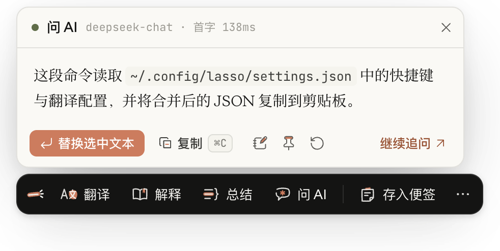
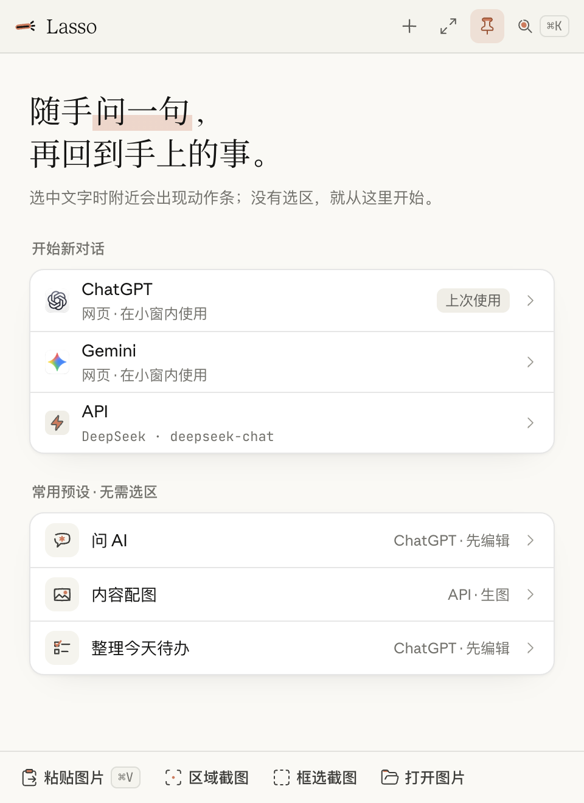
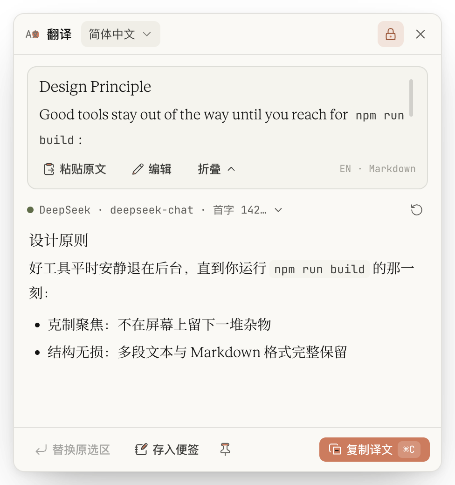
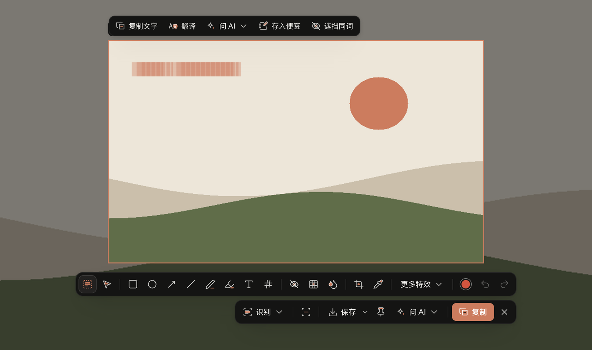
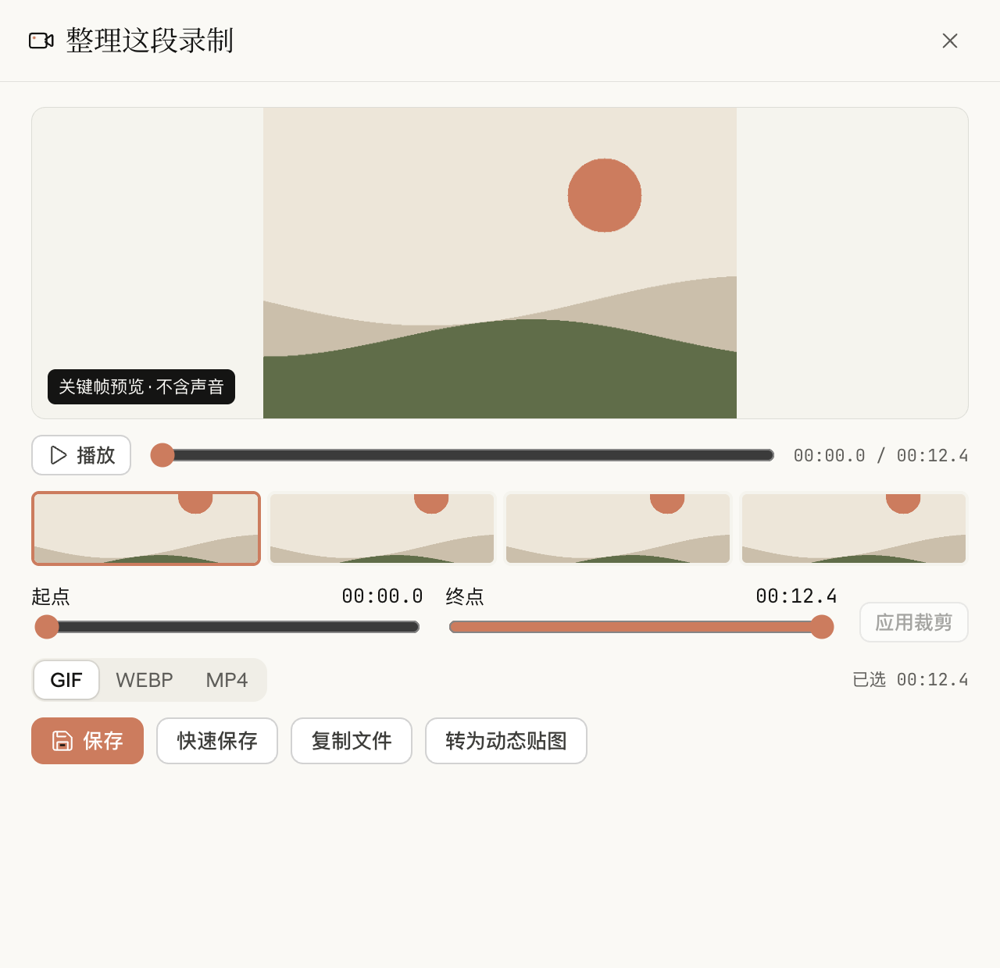
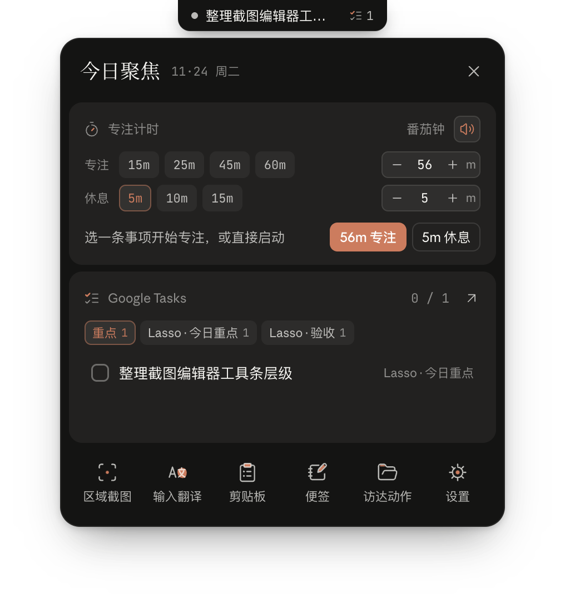
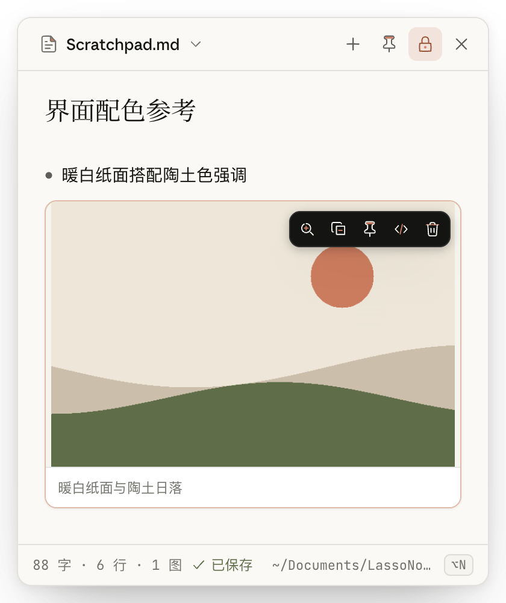
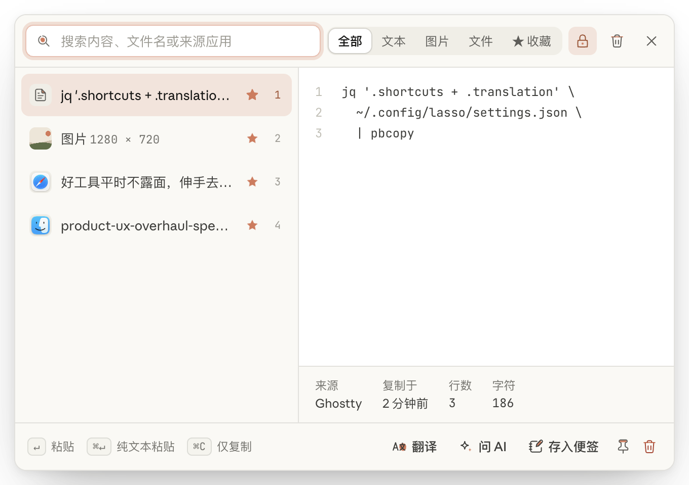

# Lasso

Mac 上不打断当前工作的 AI 小窗。

在任意应用里选中文字，点击附近的动作条即可翻译、总结、解释、存入便签，或把内容送进 ChatGPT、Gemini 和兼容 API；没有选区时也能随时唤起小窗提问。当前版本 **0.8.6**，同时内置原生截图与原地标注、AI 生图、屏幕贴图、录屏，以及刘海岛、浮动便签、剪贴板历史、访达动作面板和窗口分屏。


<!-- 演示动图由另一个任务生成，后续补上 -->

## 核心功能

### 划词动作条与预设

- 拖选文字后在选区旁浮现墨色动作条，默认内置「翻译」「存入便签」以及启用的对话预设（前 5 项直接展示，其余收进 `···`），支持在设置中拖拽排序、隐藏条目、自定义图标和切换图标/文字显示方式。
- 目标为 **API** 的文本预设直接在动作条旁展开流式快答卡片，支持替换原选区、复制、存入便签、贴图、重试，或携带上下文一键进入主窗继续追问。
- 支持按应用（bundle ID）配置背景提示词，只跟随明确的划词来源注入一次；无选区、图片和后续追问不注入。忽略应用规则可按划词、快捷键、截图候选分范围配置。



### 对话目标与多任务小窗

- 统一接入 **ChatGPT 网页**、**Gemini 网页** 与 **OpenAI 兼容 API** 三类目标。无选区时从菜单栏或 `⌘K` 指令面板直接新建对话、运行预设或按 `Tab` 临时切换目标。
- 网页目标在真实页面输入框完整填入长文本（不走 URL 参数、不截断），支持先编辑或直接发送、临时对话、预设模型与思考强度，以及单图附带提问；API 目标提供本地原生多轮图文流式对话页，可随时切换连接与模型、停止生成或清空上下文。
- 顶部标签优先显示，放不下时收纳到溢出列表；隐藏或切换不打断后台生成，置顶后点击窗外不隐藏。



### 翻译浮窗

- 合并划词翻译与输入翻译（默认快捷键 `⌥T`），支持 **内置极速**、**DeepL / DeepLX**、**Google Translate** 与 **LLM API**（流式输出）多引擎切换，提供中英自动互译及日、韩、法、德等目标语言。
- 自动保留原选区的富文本与 Markdown 结构（标题、列表、行内代码、代码块、链接与表格）；原文区支持实时 Markdown 编辑与折叠，窗口按译文内容自适应宽高。
- 可在设置中开启「复制即译」（双击 `⌘C` 或每次复制触发，自动跳过密码管理器与系统隐私剪贴板）；译文可一键复制、替换原选区、存入便签或钉为 Markdown 贴图。



### 截图、标注与 AI 生图

- 基于 ScreenCaptureKit 与 AppKit 原生取图，支持**框选、智能区域（自动识别窗口、界面元素、边缘与色块）、窗口、前台窗口、全屏**五种模式，以及**纵横滚动长截图**（可微调拼接缝）、延时截图（3 / 5 / 10 秒）、重截上次区域和常用尺寸预设。
- 截图后原地进入两排紧凑编辑器：支持矩形/多边形/自由套索/多区域裁剪，旋转翻转与灰度亮度调整，箭头、直线、矩形、椭圆、画笔、高亮、文字、序号等标注，遮挡、马赛克、模糊、联动遮挡同词、聚光灯、放大镜、水印与取色。
- 内置 Apple Vision 本地 OCR，可直接在截图上拖选文字（文本/代码模式）和识别条码；遮挡后自动重新识别并剔除被遮挡行。接入外部视觉服务后支持图片翻译、表格提取导出与 LaTeX 公式识别。截图历史默认开启（50 条 / 30 天 / 512 MB）。
- 截图、剪贴板图片、本地图片或访达服务「使用 Lasso 生图」均可交给图片预设或独立 **AI 生图窗**：API 生图支持参考图、比例与分辨率（1K / 2K / 4K）、张数（1–4）、多版本历史和基于结果继续修改，也支持 ChatGPT / Gemini 网页生图预设。



### 贴图与录屏

- **贴图**：可将截图、剪贴板内容、文字（支持 Markdown 渲染）、色值或文件置顶钉在桌面；支持滚轮缩放或调透明度、鼠标穿透、锁定、缩略图模式、图上选字、原位再次标注，以及分组工作空间、一键排列与启动时恢复（默认开启）。
- **录屏**：支持区域、窗口与全屏录制，可配倒计时（0 / 3 / 5 秒）、帧率（15 / 24 / 30 / 60 FPS）、系统声音与麦克风、摄像头画中画、按键与鼠标点击提示；录制结束后在回看面板按关键帧裁剪起止点，导出 **MP4 / GIF / WebP** 或转为动态贴图，异常退出可恢复会话。



### 刘海岛、访达面板与窗口分屏

- **刘海岛**：贴附屏幕顶部，外接屏自动避让状态栏图标，全屏模式可选隐藏、保持显示或黑底白字时间；展开面板内置**番茄钟**（自定义专注/休息时长与结束提示音）、**Nook 提醒桥**（Google Tasks 清单标签、后台服务告警、额度重置与 10m / 30m / 2h 延后提醒）、四边屏幕光效提示与常用工具快捷入口。
- **访达动作面板**（默认 `⌃⌥F`，可选在 Finder 中键或长按右键唤起）：读取当前 Finder 目录与选中项，支持模板新建文件（`.md` / `.txt` / `.py` / `.json` / `.sh`）、多种格式复制路径、发给 AI、在终端（Ghostty / Terminal / Warp / iTerm）或编辑器（Cursor / VSCode / Zed）打开、剪切粘贴移动、彻底删除、图片原地转 WebP、Vision OCR 复制或贴图，以及快速移动或创建软链到常用目录、仓库与 worktree。
- **窗口分屏**：内置常用分屏与跨屏快捷键（`⌃⌥←/→/↑/↓/↵`、1/3 与 2/3 分屏、`⌘⌃⌥←/→` 移至相邻显示器，均可在设置中修改或清空），同时支持原生拖拽窗口到屏幕边缘磁吸分屏（避让程序坞，上下边缘带停顿防误触）。



### 浮动便签

- 默认快捷键 `⌥N`，采用常驻实时 Markdown 编辑器（失焦不退回预览态），支持待办勾选、项目符号与编号自动续写、多笔记下拉切换与搜索。
- 支持直接粘贴或拖入图片并内联预览、点击放大查看、复制或钉为贴图；动作条、翻译浮窗和剪贴板历史均有一键「存入便签」入口。
- 笔记以纯 `.md` 文件和 `assets/` 目录保存在 `~/Documents/LassoNotes/`，可随时用其他编辑器打开。



### 剪贴板历史

- 默认快捷键 `⌥V`，双栏展示文本、图片与文件复制历史，支持全文与来源应用搜索、按类型和收藏筛选，以及来源应用、字数/行数、图片尺寸与体积等元数据预览。
- 自动跳过常见密码管理器（1Password、Bitwarden、Apple 密码、钥匙串访问、KeePassXC、LastPass）和系统标记的隐私剪贴板内容。
- 选中任意历史条目可直接粘贴、纯文本粘贴、仅复制、翻译、问 AI、存入便签或钉为贴图。



**独立设置与同步**：通过 `⌘,` 打开独立设置窗，8 个模块（通用与外观、划词与动作条、AI 预设与生图、翻译、模型与 API 连接、截图贴图与录屏、桌面套件、快捷键与同步）修改后即时自动保存。主窗与截图全局快捷键默认不绑定（`⌥Space` 留给 Raycast）；偏好、快捷键与预设支持配置包导出/导入或通过 WebDAV 同步。

## 安装与构建

### 从 Release 下载安装

[GitHub Releases](https://github.com/ump45nose/lasso/releases) 的 v0.8.6 附件是交付包 `Lasso-0.8.6-delivery-arm64.zip`（仅 Apple Silicon）和对应的 `.sha256` 校验文件。包内的 `Lasso.app` 不带签名，由随包的 `install.sh` 用本机固定开发签名重新签名后，安装到 `~/Applications/Lasso.app`。安装前需要：

- Node.js：`install.sh` 依赖它运行，会在 `PATH`、`/opt/homebrew/bin`、`/usr/local/bin` 中查找，也可以用 `LASSO_NODE` 指定路径。
- 登录钥匙串里已有 `Lasso Local Development` 签名身份：在源码目录运行一次 `npm run signing:setup` 即可创建，之后会一直复用。

```sh
shasum -a 256 Lasso-0.8.6-delivery-arm64.zip   # 与 .sha256 文件中的值对照
ditto -x -k Lasso-0.8.6-delivery-arm64.zip Lasso-0.8.6
cd Lasso-0.8.6
./install.sh --dry-run   # 只做检查：文件完整性、架构、系统版本、签名身份
./install.sh             # 安装并启动；如果旧版本正在运行，会先退出旧版本
```

应用**尚未经过 Apple 公证**。如果首次打开被 macOS 拦截，到「系统设置 → 隐私与安全性」底部找到 Lasso，点击「仍要打开」。

### 从源码构建

要求 macOS **14.2+**、Node.js **22.12+**、npm、Xcode Command Line Tools。当前通过验证的架构为 Apple Silicon；打包按本机架构生成，不提供通用包。

```sh
gh repo clone ump45nose/lasso
cd lasso
npm ci
npm run signing:setup  # 新 Mac 创建本机固定开发签名，已有时复用
npm run package
open release/Lasso-darwin-$(node -p process.arch)
```

若未安装 Command Line Tools，先运行 `xcode-select --install`。原生模块会查找当前 Node 安装及 Homebrew 的开发头文件；自定义安装可通过 `NODE_INCLUDE_DIR` 指定包含 `node_api.h` 的目录。

打包签名需要登录钥匙串处于解锁且允许 `codesign` 使用本机证书的状态。

GitHub Actions 包含 Linux 检查（类型检查、UI 规则检查、翻译格式测试与 JS 构建）和 macOS 打包工作流。打包工作流需要手动触发，可以选 `arm64`，也可以选 `arm64` + `x64` 两种架构，产出 ZIP / DMG、交付包和 SHA-256 校验文件，作为构建产物上传；工作流不会自动发布 Release，附件需要手动上传。版本标签与 `package.json` 保持一致，格式为 `v*`（例如 `v0.8.6`）。CI 用 `npm run package -- --release` 做临时签名，不读取本机证书；本机构建继续复用固定签名。

源码调试用 `npm start`，已有构建用 `npm run start:built`。调试进程使用 Electron 身份，但与安装版共用数据目录；不能用调试运行替代安装版的权限验收，也不要同时运行两者。

## 快速上手

1. **安装并授予权限**：将 `Lasso.app` 放入 `~/Applications/` 并从 Finder 启动。首次授予**辅助功能**权限（划词取词、动作条替换原文和窗口分屏均依赖它），在「设置 → 划词与动作条」确认状态后实际拖选一段文字验证；使用截图和录屏时再授予**屏幕录制**权限；录屏涉及声音或画中画时按需授予**麦克风 / 摄像头**权限；使用访达面板时允许控制 **Finder**。
2. **登录网站**：打开小窗分别登录 ChatGPT 和 Gemini，登录状态保存在独立的持久化分区中，重启后自动保持。
3. **配置 API 连接**：在「设置 → 模型与 API 连接」添加 OpenAI 兼容接口地址、API Key 和常用模型，即可启用原生 API 多轮对话、动作条快答卡片、LLM 翻译与 AI 生图；外部视觉识别（图片翻译/表格/公式）与 WebDAV 同步按需配置。

详细的数据取舍与换机验收顺序见 [迁移步骤](docs/handoff.md#新-mac-迁移步骤)。

## 实现边界与数据目录

### 实现边界

- Electron + React + TypeScript；通用取词复用 `selection-hook`（辅助功能优先，复制兜底默认关闭），无需购买 PopClip。
- 网站保留自己的账号、模型、附件与聊天界面；本地只管理预设、任务、窗口和适配。不复制浏览器凭据，不从网页静默切换到 API。
- API 仅用于预设或功能中显式选择的连接（原生 API 对话、动作条快答卡片、LLM 翻译、AI 生图与外部视觉识别），密钥经 macOS `safeStorage` 加密存储在本机。
- 后台闲置回收默认 **30 分钟**（可在设置中按 1–1440 分钟调整或关闭）；网页任务需同时满足已完成、无草稿/附件/待处理操作、可恢复且非临时对话才释放资源，切回后恢复原链接、不重发提示词。退出后不恢复本次任务列表，也不保存完整网页聊天副本。截图编辑器闲置时同样休眠；截图历史与贴图各自独立持久化。
- 本地外壳采用暖白纸面（`#FAF9F5`）、墨色文字（`#141413`）、陶土色强调（`#D97757`），以及衬线正文 + 无衬线控件 + 等宽数据的字体分工，支持手绘或线性图标与跟随系统主题；远程网页样式由网站控制。窗口与设置过渡跟随 macOS「减少动态效果」。

### 数据目录

- 应用数据目录固定为 `~/Library/Application Support/mac-ai-prompt/`，应用身份固定为 `local.mac-ai-prompt`。
- 浮动便签默认以纯 Markdown 文件及 `assets/` 图片保存在 `~/Documents/LassoNotes/`。
- 预设与偏好可通过配置包、WebDAV 或私下复制 `presets.json` / `settings.json` 迁移；网站登录分区、加密 API 与服务凭据、WebDAV 密码、签名私钥、运行数据与安装产物不进入 Git。

## 文档与代码入口

- [方案、进度、验收缺口与迁移](docs/handoff.md)：接手工作的主入口。
- [界面规则](docs/design/ui-rules.md)：颜色令牌、字体分工、图标与动效规范。
- [阶段 0—6 实施路线](docs/implementation-plan.md)、[阶段 4—6 设计](docs/next-phases-design.md)。
- [截图 S1—S4 方案](docs/screenshot-implementation-plan.md)：包括免费开源复用研究与原型证据。
- [已确认的交互原型](docs/design/index.html)：可直接用浏览器打开；历史设计参考，不代表功能已完成。
- [开源复用与许可](docs/open-source.md)。

主进程入口 `src/main/index.ts`，任务与资源所有者 `src/main/tasks.ts`；网站操作集中在 `src/main/adapters/`，划词与动作条在 `src/main/selection.ts` / `action-bar.ts`，API 连接与生图在 `src/main/media-service.ts` / `media-window.ts`，截图、贴图与录屏在 `src/main/capture/` 与 `native/`，刘海岛、翻译、剪贴板、便签与访达面板在 `src/main/island*.ts`，WebDAV 同步在 `src/main/sync-webdav.ts`。本地界面在 `src/renderer/`，受限 IPC 在 `src/preload/`，共享契约在 `src/shared/`。

## 许可

Lasso 采用 [MIT 许可证](LICENSE)。第三方依赖、字体、品牌素材及内置提示词遵循各自的许可；复用说明见 [开源复用](docs/open-source.md) 和 [提示词署名](assets/third-party-prompts.txt)。
