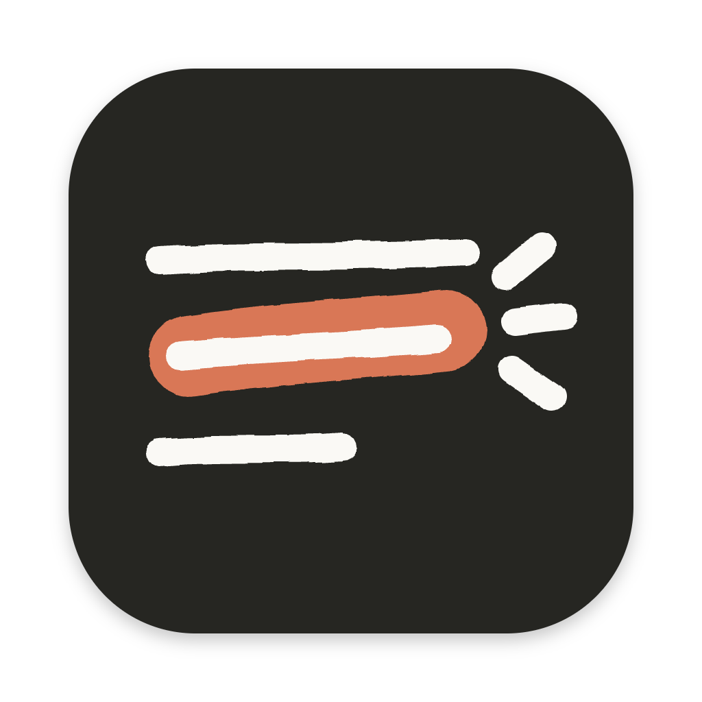
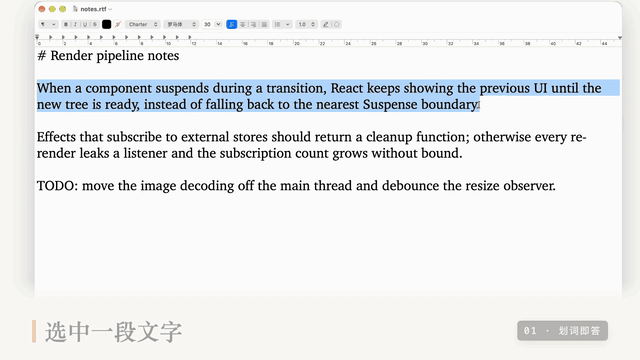
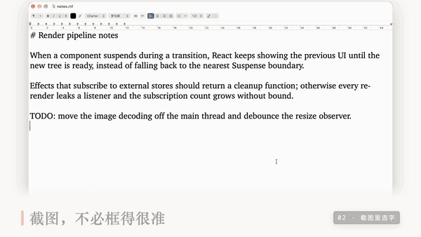
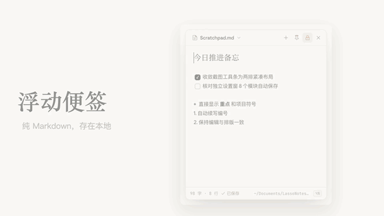

<p align="center">
  
</p>

<h1 align="center">Lasso</h1>

<p align="center"><b>不用切走，就在原地。</b><br>选中文字或截一张图，答案就出现在旁边。Mac 上的 AI 小窗。</p>

<p align="center">
  <a href="https://github.com/ump45nose/lasso/releases/latest">下载 0.8.6</a> ·
  <a href="https://github.com/ump45nose/lasso/releases/download/v0.8.6/Lasso-0.8.6-demo.mp4">观看 70 秒演示</a> ·
  macOS 14.2+ · Apple Silicon
</p>

[](https://github.com/ump45nose/lasso/releases/download/v0.8.6/Lasso-0.8.6-demo.mp4)

## 三个瞬间

### 划词即答

在任何应用里选中一段文字，动作条就出现在选区旁。点「翻译」，译文流式出现在原文下方，再点一下就替换原选区。不切窗口，也不复制粘贴。


动作条里的每一项都是预设：翻译、解释、总结、问 AI、存入便签，可以排序、隐藏或自定义。目标是 API 的预设直接在选区旁展开快答卡片。

### 截图里选字

截图时自动识别窗口与段落，不用框得很准。截好后直接在图上拖选文字，复制、翻译、问 AI 或遮挡同词。文字识别用 Apple Vision，在本机完成。



### 接着问

一个小窗同时接入 ChatGPT 网页、Gemini 网页和 OpenAI 兼容 API。划词、截图和剪贴板里的内容都能带着上下文进来继续追问，`⌘K` 随时切换目标。

## 还有这些



| 工具 | 一句话 |
| --- | --- |
| 翻译浮窗 | DeepL / Google / LLM 多引擎，保留 Markdown 与代码块 |
| 截图标注 | 箭头、马赛克、聚光灯、放大镜、水印，长截图与延时截图 |
| 贴图 | 截图、文字或色值钉在所有窗口之上，可穿透、可再编辑 |
| 录屏 | 区域 / 窗口 / 全屏，按键与点击提示，裁剪后导出 MP4 / GIF / WebP |
| 刘海岛 | 番茄钟、提醒与常用工具，贴在屏幕顶端 |
| 浮动便签 | 纯 Markdown，存在 `~/Documents/LassoNotes/` |
| 剪贴板历史 | 文本、图片、文件可搜索，自动跳过密码管理器 |
| 访达面板 | 新建模板文件、复制路径、在终端或编辑器打开、转 WebP |
| 窗口分屏 | 快捷键与拖到边缘磁吸 |

快捷键都可以在设置里修改或清空；偏好、预设与快捷键支持配置包导出或 WebDAV 同步。

## 安装

<details>
<summary>从 Release 安装（Apple Silicon）</summary>

v0.8.6 附件是 `Lasso-0.8.6-delivery-arm64.zip` 和对应的 `.sha256`。包内的 `Lasso.app` 不带签名，由随包的 `install.sh` 用本机固定开发签名重新签名后安装到 `~/Applications/Lasso.app`。安装前需要：

- Node.js（`install.sh` 依赖它；也可以用 `LASSO_NODE` 指定路径）
- 登录钥匙串里的 `Lasso Local Development` 签名身份：在源码目录运行一次 `npm run signing:setup`

```sh
shasum -a 256 Lasso-0.8.6-delivery-arm64.zip   # 与 .sha256 中的值对照
ditto -x -k Lasso-0.8.6-delivery-arm64.zip Lasso-0.8.6
cd Lasso-0.8.6
./install.sh --dry-run
./install.sh
```

应用尚未经过 Apple 公证。首次打开被拦截时，到「系统设置 → 隐私与安全性」底部点击「仍要打开」。

</details>

<details>
<summary>从源码构建</summary>

需要 macOS 14.2+、Node.js 22.12+、Xcode Command Line Tools。

```sh
gh repo clone ump45nose/lasso && cd lasso
npm ci
npm run signing:setup
npm run package
open release/Lasso-darwin-$(node -p process.arch)
```

macOS 打包工作流需要手动触发，产物作为构建附件上传，不自动发布 Release。更多说明见 [docs/handoff.md](docs/handoff.md)。

</details>

**首次使用**：授予「辅助功能」权限（划词与替换原文需要），截图和录屏时再授予「屏幕录制」；在小窗里登录 ChatGPT 和 Gemini，或在「设置 → 模型与 API 连接」填入 OpenAI 兼容接口。

## 隐私

网站保留自己的账号与聊天界面，Lasso 不复制浏览器凭据，也不会从网页静默切换到 API。API 密钥经 macOS `safeStorage` 加密保存在本机。OCR 在本机完成。

## 了解更多

- [方案、进度与迁移](docs/handoff.md)
- [界面规则](docs/design/ui-rules.md)
- [开源复用与许可](docs/open-source.md)

Lasso 采用 [MIT 许可证](LICENSE)。
