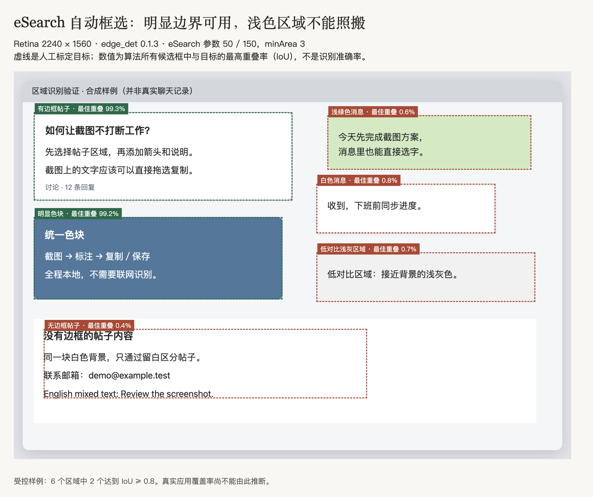
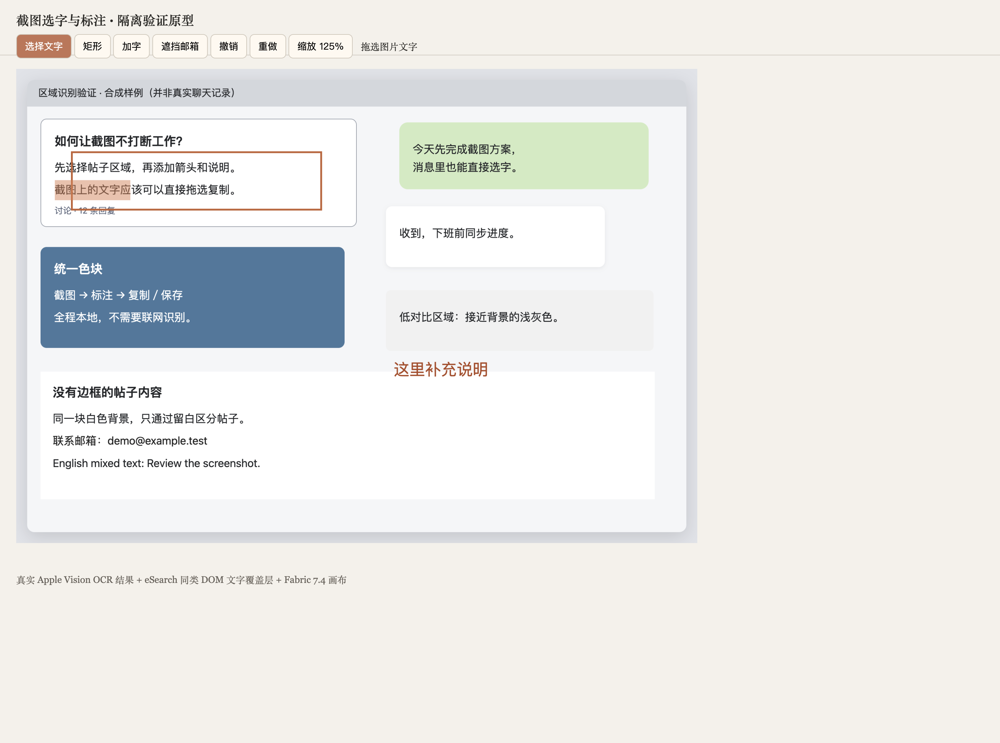
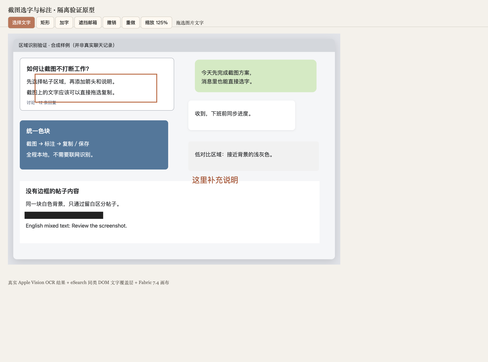

# Lasso 截图能力：验证结论与实施方案

2026-10-23 · 状态：S1 代码已接入并打包为 0.3.0；受控交互验证通过，真实应用验收等待解锁桌面。S2—S4 尚未实施。

## 1. 结论：复用编辑能力，补强自动识别

采用 **Lasso 内置截图模块 + eSearch 可提取的标注逻辑/Fabric + macOS 原生取图与文字识别接口**。

- eSearch 的现有视觉自动框选不能独自满足帖子、消息、统一色块需求。保留其边缘候选框，同时增加系统窗口、辅助功能元素和同色区域候选。
- 图上选字与标注的分层方案可行；已经在隔离原型中用真实 OCR 结果及鼠标输入走通主要交互。
- 不嵌入完整 eSearch 应用，不引入其搜索、翻译、录屏、浏览器及独立账号配置。
- 不要求购买软件，也不要求用户额外安装和维护另一款截图工具。现有 Shottr 剪贴板流程继续可用。

## 2. 已做验证，以及它改变了什么

### 2.1 验证材料和方法

- eSearch 源码快照：`9bd5e9226d7ed3671ec7be0210db6e2fe5fe0e3d`，package version `15.6.0`；这是源码快照，不把它当作已验收的发行版。
- 直接执行该快照依赖的 `edge_det 0.1.3`，使用 eSearch 的参数 `lowThreshold=50, highThreshold=150, minArea=3`；另以 `20/60/3` 作一次降低阈值的对照。上游图像自动框选默认关闭，本次直接运行其启用后的算法路径。
- Electron 实际渲染一张 2240 × 1560 Retina 图，包含有边框帖子、两种消息气泡、明显色块、低对比浅灰区域和无边框帖子六个受控样例。区域真值来自样例 DOM 的实际矩形，而非算法预测。
- 另外加载并截取 [Snipaste 的公开 GitHub 讨论](https://github.com/Snipaste/feedback/issues/3535)，将可完整看到的一条评论卡片作为真实网页样例。
- 同时核查了 eSearch 在鼠标位置筛选候选及单击选择候选的代码。下表报告所有候选里的最高 IoU，即“候选中是否至少存在一个合适框”，不是总体识别准确率。IoU 为预测框与目标框的交集面积除以并集面积。
- 共存原型使用 `Fabric 7.4.0`、真实 Apple Vision 中英文 OCR 结果和与 eSearch 同类的 DOM 文字覆盖层；没有运行整套 eSearch，也没有完成其标注页的生产移植。

### 2.2 自动框选：现有算法不能单独交付

| 目标 | eSearch 参数下最佳 IoU | 降低阈值后最佳 IoU | 判断 |
|---|---:|---:|---|
| 有明显边框的帖子 | 99.3% | 99.3% | 可找到完整区域 |
| 浅绿色消息气泡 | 0.6% | 5.9% | 漏掉气泡区域 |
| 白色消息气泡 | 0.8% | 4.7% | 漏掉气泡区域 |
| 明显统一色块 | 99.2% | 99.2% | 可找到完整区域 |
| 低对比浅灰区域 | 0.7% | 5.8% | 易与背景混合 |
| 无边框帖子内容 | 0.4% | 12.0% | 无法推断内容边界 |
| 真实 GitHub 评论卡片 | 1.1% | 39.7% | 降阈值仍未找到完整卡片 |

以 IoU ≥ 0.8 为本轮候选命中的判据，六个受控样例命中 2 个；真实评论卡片未命中。不能把这组小样本比例推广成所有应用的准确率。

该图生成约 1105 个候选，许多是字形等细碎边缘。最后一轮本机运行中，三次暖调用中位数约 117 ms；真实网页约 125 ms。它应在后台一次计算、过滤并缓存，不能放在每次鼠标移动的同步路径。此数值只衡量这两张图的算法调用，不包含取图、窗口显示和整个产品延迟。

**补充实验：** 小范围颜色采样 + 同色连通区域包围盒，在容差 4 时覆盖六个合成区域中的五个（IoU ≥ 0.8）；无边框帖子只能圈到更大的白色容器。容差 12 时低对比区域也会扩散到背景。这证明颜色补充值得做，但固定容差不能直接作为生产策略，更不能替代界面结构识别。该实验不是 eSearch 自带能力。

### 2.3 选字与标注：交互机制可行

在真实渲染原型中完成：

- 用鼠标拖选局部文字，得到 `截图上的文字应`，不是整段 OCR 文本。
- 切换矩形工具，拖动创建矩形，再拖动移动该标注。
- 添加可编辑文字并输入 `这里补充说明`。
- 返回文字模式，仍能选中同一段；从 90% 切换至 125% 缩放后仍能选择。
- 本地 Copy 处理器输出选中文字。此项用内存中的 ClipboardEvent/DataTransfer 验证，没有改写用户的系统剪贴板；安装版 Cmd+C 仍需验收。
- 实色遮挡邮箱后，从可选文字层移除对应行；撤销恢复，重做再次排除。
- 导出合成 PNG，再做一次真实 OCR：新加的说明可识别，被遮挡邮箱未检出。

原型中识别约 16 行文字用时约 0.29 秒，但出现了个别汉字误识别。因此默认后台 OCR，不阻塞复制图片和标注；复制文字需保留“识别文字”的属性，不能承诺与原文百分百一致。

**本轮未验证：** 微信、钉钉等真实应用的 AX 元素边界；实际 macOS 全屏取图权限；多显示器混合缩放；完整 eSearch 工具迁移；系统剪贴板与安装版；四个 AI 目标的截图端到端。这些分别纳入下面对应阶段，不用原型结果替代。

## 3. 完整功能范围

### 本次必须交付

1. **截图入口**：菜单栏、Lasso 本地入口、可配置独立快捷键。默认不抢占现有系统/Shottr 快捷键，不使用 Option+Space。选择快捷键只需配置一次。
2. **选区**：可见屏幕区域、全屏、窗口、内部区域自动框选；鼠标悬停提示、层级切换、手动画框、拖边微调、方向键微调。多显示器可分别进入截图，正确处理负坐标与 Retina；跨显示器合成不作为首批能力。
3. **标注**：箭头、直线、矩形、椭圆、画笔、高亮、添加文字、递增序号；颜色/粗细/字号，选中、移动、调整、删除，撤销/重做；裁剪。
4. **隐私处理**：马赛克、模糊、实色遮挡。默认将敏感信息引导至实色遮挡；不能把马赛克、模糊当成可靠脱敏。
5. **图上选字**：截图结果与贴图都能拖选局部文字和复制，不要求到文本面板；首批以中文、英文和混排为主。
6. **贴图**：多张独立悬浮贴图，置顶、移动、缩放、透明度、鼠标穿透、临时隐藏/恢复、关闭、重新编辑。与“暂不做 AI 多窗口”分开。
7. **输出**：复制图片、保存 PNG/JPEG、复制选中文字、发送图片或选中文字到现有预设。取色和像素放大镜跟随现成截图编辑能力保留。
8. **输入兼容**：现有剪贴板单图入口保留；提供“编辑图片”，进入同一套编辑/选字界面。网页自身粘贴不被全局拦截。

### 可选与后续

- 退出后的贴图及可编辑标注恢复：仅上游能力可低成本接入时带上，非本次验收项。否则退出不恢复，用户可以手动保存。
- 滚动长截图明确后续做；录屏、拼图、截图历史库、云上传、背景美化、专业测距不因“对齐常用操作”而自动进入本次。
- 本轮不扩展 AI 多窗口、语音、Live2D、论坛入口、网站级提示词或新 AI 目标。

## 4. 用户操作与视觉方向

### 截图到输出

`主动触发 → 冻结屏幕 → 悬停候选/手动选区 → 截图结果＋操作条 → 选字/标注/复制/保存/贴图/AI`

- 不自动进入聊天。OCR 到达前已经可以标注、复制图片和保存。
- 候选框有稳定层级；滚轮或键盘切换较小/较大区域，移动鼠标不会在多个近似框之间反复闪烁。手动画框始终可用。
- 默认可选择文字。点击画笔、箭头、文字等工具后由标注层处理输入；返回“选择文字”后恢复选字。边缘调整手柄独立处理裁剪，不把正文拖选当成重画选区。
- `Cmd+C` 在存在文字选区时复制文字，否则复制合成图片。工具栏仍明确分开“复制图片”和“复制文字”，避免隐含状态造成误操作。
- 输入新增标注文字时，文本编辑器优先处理选字、复制和撤销；不触发外层的选字/截图快捷键。
- 截图编辑不是 AI 临时小窗，不沿用点击窗外自动隐藏规则。取消、完成、贴图或发送是明确的离开动作。
- 贴图正文可选字；移动用边缘/拖动柄，或空格拖动。穿透模式须能由菜单栏或快捷操作退出。
- 保留当前暖色、衬线体主视觉。工具组紧凑，文字字号可读；进入/退出和工具切换使用短淡入，不让候选框、鼠标或画笔轨迹追逐动画。

### 发给 AI

- “整图”传递当前裁剪和标注后的最终像素；“选中文字”传递明确选择的 OCR 文本。入口显示本次输入类型，不因选择文字而悄悄附带原图。
- 目标、模型、思考强度、先编辑/直接发送沿用预设；临时目标仍放二级入口。
- 网页先编辑仍直入网站输入框；CLI 先编辑仍进入其聊天输入框。
- 原有应用提示词规则保持：只有真实应用划词来源注入。截图、剪贴板图及其 OCR 选字不伪造应用划词来源，也不沿用旧 `lastSelection`。普通追问不重复注入。
- 单次 AI 任务仍一张图片；多张贴图不等于一次发送多图。

## 5. 复用方案与代码边界

| 部分 | 首选 | 接入方式与限制 |
|---|---|---|
| 屏幕位图/窗口矩形 | Electron `desktopCapturer` + CoreGraphics 窗口列表 | S1 实际采用现有 Electron 取图接口，按 display_id 匹配屏幕。原生桥接只查询窗口/AX，不另装截屏引擎。 |
| 截图编辑 | eSearch 的标注工具实现 + Fabric 7.4 | 按工具、历史、导出拆出适配层；只迁移本次需要的能力。Fabric 的对象编辑/缩放/序列化直接复用。 |
| 视觉边缘 | `edge_det 0.1.3`，Apache-2.0 | 只作候选来源之一；工作线程运行、过滤字形噪声、去重。 |
| 同色区域 | 本轮小实验的独立实现方向 | 多容差候选，约束在当前窗口/候选区域内；候选层级让用户选择，不假装知道语义。 |
| 系统控件边界 | macOS AX 接口 | 一个薄的本地桥接，不复制另一套辅助功能监听。只在截图模式按需查询，有超时预算；AX 不响应不阻塞画框。 |
| OCR | Apple Vision | macOS 本地框架，免费使用但不是开源 OCR 引擎；避免首版额外下载大模型。复用文字覆盖层方式，不引入 eSearch 的整个 OCR 编辑器。 |
| 贴图 | eSearch 贴图交互参考 + Electron 独立本地窗口 | 共用截图文档与渲染模块，不创建 AI Task。 |

eSearch 自身采用 GPL-3.0；复制的工具代码须保留来源、许可和修改记录，不能因为底层 Fabric 是 MIT 就把上层代码也标作 MIT。当前个人自用验证没有对外发布。未来分发前按实际复制/组合范围核对许可义务，不能把进程拆分视作自动规避许可的手段。

eSearch 原截图页约 5100 行，混合了设置、IPC、截图、工具与导出；其原窗口配置允许 Node 集成。**不复制这些窗口安全配置。** 截图编辑器使用本地受信页面、隔离 preload、校验过的 IPC；ChatGPT/Gemini 页面继续没有本地文件或截图接口。

### 拟落点

- `src/main/capture/`：`CaptureManager` 唯一拥有截图会话及贴图资源；取图、权限、窗口布局、取消与释放。
- `src/main/capture/candidates.ts`：合并窗口/AX/边缘/颜色候选，空间命中、排序、父子层级与稳定选中。
- `src/renderer/capture/`：截图结果、标注工具、OCR 文字层、贴图；独立入口，不塞进 AI 聊天组件。
- `src/preload/capture.ts`：仅暴露截图窗口所需的类型化接口。请求带文档 ID 和版本，不接受任意磁盘路径。
- `native/`：薄的 Vision/AX 桥接，优先打包为宿主进程加载的本地模块，沿用 Lasso 固定签名身份，避免再造一个要独立授权的用户应用。
- `src/main/images.ts`：在现有剪贴板 `capture()` 之外新增“从合成 PNG 登记图片”入口，保留原行为；任务拿到独立、不可变图片副本。
- `src/main/index.ts` / `src/shared/contracts.ts`：增加截图动作和带来源类型的输入交接；旧预设、原有划词及 `LaunchOptions.imageId` 保持可用。OCR 文本经显式无应用来源的路径，不复用旧选择状态。
- `src/main/tasks.ts`：只接收最终文字/图片与已有执行配置，不管理截图编辑历史、候选或贴图窗口。

### 数据与状态

一份截图文档包含：原始像素引用、像素尺寸、屏幕位置及比例、裁剪矩形、标注对象、隐私遮罩、OCR 版本/结果、编辑版本。

- 屏幕坐标用 macOS 逻辑点；位图、OCR、标注和裁剪统一用原始图片像素。只有显示时应用缩放变换，跨屏时重新计算。
- `idle → selecting → editing → pinned / exporting / cancelled`；OCR 与候选计算带文档版本，裁剪/替换后丢弃旧结果。
- 原图由主进程管理。本地截图编辑器通过受限引用加载编辑所需像素；AI 外层继续只接收 ID/缩略图，不在 `ShellState` 广播完整位图或标注历史。
- 保存、复制与 AI 发送共用一条最终合成路径。不能一条路径有遮挡、另一条路径发送原图。
- 隐私工具改动后，立即清除旧文字选区，并停用受影响 OCR 文字；在遮挡后的合成图上重建 OCR。原型为保守移除整行，生产实现可精确到字符，但不能先泄漏再异步纠正。
- 标注序列化、隐藏文本层和原图不会随导出图片/AI 附件发送。撤销可在本地恢复编辑前状态，不能回溯已经交给网站的附件。
- 任务附件拥有独立副本，发送成功/放弃后的清理不影响还在编辑的截图或贴图。失败保留任务待处理输入，重试不重新截取屏幕。

## 6. 分阶段实施

### S1：原生取图与自动区域识别

**先做这一阶段，解决当前最大未知，再投入完整工具移植。**

1. 接菜单栏和可配置快捷键，建立一次截图会话；冻结位图后显示遮罩，排除自身 UI；Esc 取消并释放。
2. 接 Electron `desktopCapturer`，对照窗口位置、遮挡关系与屏幕缩放验证真实像素范围。截的是用户当下可见内容，不暴露被其他窗口遮住的内容。
3. 建立统一坐标变换和候选结构；窗口、AX、edge_det、同色连通区域分别输出候选。
4. 快路径先出窗口/手动画框；边缘在后台算一次；颜色和 AX 查询按鼠标停留节流。只显示少量有效候选，滚轮切层级。
5. 用 Chrome 帖子、微信/钉钉消息、浅灰面板等实际画面验证。只需人工选择代表性非敏感内容，无需发送测试消息。

**完成条件：** 手动截图、全屏、窗口正确；帖子/消息/色块中可用的候选不会只剩整窗；同一目标连续悬停不抖动；慢 AX 不冻结界面；拒绝权限时原有划词和网页能力仍可用。

**决策门槛：** 若真实消息/帖子无法提供 AX 边界，且视觉候选仍无法形成合理区域，明确列出失败应用和样例，在本阶段调整识别方案，不以“已有手动画框”宣告自动识别需求完成。

### S2：完整标注与直接选字

1. 提取 eSearch 工具逻辑，接 Fabric 画布、工具样式、撤销/重做与统一导出；不迁移原来的设置系统与 Node-enabled 页面。
2. 补齐第 3 节的箭头、形状、画笔、高亮、加字、序号、裁剪和隐私工具。文字编辑与画布历史分清焦点。
3. Vision 异步识别，文字框和字符信息绑定原像素坐标；实现图上拖选、跨行选择、复制、缩放和裁剪后的定位。
4. 原图层/标注层/文字命中层共享变换，工具模式决定输入归属；OCR/候选计算不阻塞画笔。
5. 固化隐私修改的文字失效、重识别及最终合成规则。

**完成条件：** 常用工具可创建、修改、删除和撤销；缩放后文字选择/标注落点不漂移；中英文混排可选取局部字符；复制、保存、AI 待发送图的像素一致；被遮挡内容不从文字层或附件泄漏。

### S3：贴图、现有图片入口与 AI 预设

1. 一个截图编辑器同时只处理一个活动文档；支持多个贴图。贴图复用文档及必要的标注数据，重新编辑不丢标注。
2. 实现置顶、移动、缩放、透明度、穿透、隐藏/恢复和关闭；停止编辑的贴图避免保持每帧重绘。
3. 剪贴板图片可选择直接问 AI 或进入截图编辑器，不强迫所有旧图片任务先经过编辑。
4. 发送合成图或所选 OCR 文字时，冻结输入版本后进入现有四目标流程。沿用预设的模型/思考强度和发送方式，不改网页及 CLI 协议。
5. 选字复制时抑制本应用的通用划词动作条重复弹出；截图 OCR 输入不携带旧来源应用。

**完成条件：** 贴图选字、再次编辑、四目标图任务与失败重试可用；剪贴板旧入口未改变；无应用提示词误注入；发送不会关闭或破坏其他后台 AI 任务。

### S4：资源、权限、安装与集中验收

1. 选区取消立即释放全屏图及工作线程；定稿裁剪后释放不再需要的全屏副本；贴图关闭释放画布/OCR及临时文件。
2. 截图线程按需启动、结束后释放；不持续截屏，不监听剪贴板。任务/贴图各自持有资源，不能套用 AI 页面 10 分钟回收规则去关掉用户贴图。
3. 继续使用当前 bundle ID、userData 和固定本地签名证书。新加原生模块嵌入包、内层到外层签名，不更换主应用身份。
4. 首次屏幕录制权限属于新能力；缺少它只阻塞取图，不阻塞既有剪贴板图片编辑。既有辅助功能授权不主动重置。安装更新后再验证一次授权保持。
5. 默认不持久化截图历史。贴图恢复只有低成本复用成立时加入，否则明确为“本次运行保留”。
6. 实现完成先重新扫描架构、输入来源、坐标变换、资源所有权和全部调用者，对照本方案，再集中执行下节验收。安装保留上一版，不删除网站登录及预设。

## 7. 集中验收清单

| 路径 | 必须观察的结果 |
|---|---|
| 自动区域 | Chrome 帖子、微信/钉钉消息、明显与低对比色块；记录是否有正确候选、默认选中是否合理和失败样例，不只测窗口 |
| 取图/坐标 | Retina、外接屏、负坐标、切屏、不同缩放、窗口部分遮挡；屏幕像素与选择框一致 |
| 标注 | 各工具创建、移动、修改、删除、撤销重做；中文输入法加字；文字编辑不触发外层动作 |
| 图上选字 | 局部中文、英文、混排、跨行、反向拖选、缩放、裁剪、贴图；Cmd+C 实际粘贴到普通输入框 |
| 隐私 | 三种隐私工具都清理相应旧 OCR；实色遮挡后导出再 OCR 不含样例敏感文本；撤销/重做与导出一致 |
| 图片来源 | 内置截图、Shottr 复制图、普通剪贴板图，旧路径仍可直接调用预设 |
| AI 交接 | ChatGPT、Gemini、Codex、Pi 各走现有附件入口；先编辑不发送，直接发送不重复；模型/思考强度配置沿用；失败保留最终合成图 |
| Pi 模型限制 | 沿用此前用户决定：无可用视觉模型时不为验收更换凭据/全局配置；验证原生图片输入与失败保留，并标明未完成模型端识图验收 |
| 应用提示词 | 原应用划词照常注入；截图、图上 OCR、无选区、普通追问均不带入旧来源 |
| 贴图 | 多张共存、穿透退出、再次编辑、缩放后选字；发送/关闭任务不误删贴图 |
| 性能 | 记录从快捷键到可操作选区、候选到达、OCR 就绪的分段耗时；标注期间无明显卡顿；不把 OCR 完成作为截图窗口显示条件 |
| 权限/更新 | Finder 启动取图；拒绝屏幕权限的提示与旧功能；固定签名更新前后辅助功能保持；无需每阶段反复重加权限 |
| 清理 | 取消、关闭、退出无本模块遗留进程/活动取图/无主临时图；后台 AI 任务不受截图操作打断 |

## 8. 来源与证据位置

- [eSearch 截图及标注源码](https://github.com/xushengfeng/eSearch/blob/9bd5e9226d7ed3671ec7be0210db6e2fe5fe0e3d/src/renderer/clip/clip_window.ts)：自动框选 `edge/getWin/inEdge/clipEnd`，Fabric 工具与导出。
- [eSearch 图上文字层](https://github.com/xushengfeng/eSearch/blob/9bd5e9226d7ed3671ec7be0210db6e2fe5fe0e3d/src/renderer/editor/editor.ts)：`addOcrText/addOcrPhoto/getImgSelect`；原实现联动独立编辑区，不能原样当作截图层。
- [edge_det](https://github.com/xushengfeng/edge_det)、[node-screenshots](https://github.com/nashaofu/node-screenshots)、[Fabric 许可](https://github.com/fabricjs/fabric.js/blob/master/LICENSE)。
- [Apple Vision 文字识别](https://developer.apple.com/documentation/vision/recognizing-text-in-images)、[AX 点位元素查询](https://developer.apple.com/documentation/applicationservices/1462077-axuielementcopyelementatposition)。
- 本文的三张 PNG 为本轮实际渲染证据，位于 `docs/assets/screenshot-validation/`。样例不含用户聊天内容。
- 隔离探针和 OCR/标注原型不属于产品交付代码；保留上述方法、数值与合成样例证据，后续按阶段在仓库内实现。

## S1 当前实现与验收状态（0.3.0）

已接入菜单栏「截图」、小窗工具栏截图按钮、设置 → 通用的独立截图快捷键。默认不绑定；Option+Space 被明确拒绝，唤起与截图快捷键不能冲突。截图窗口支持候选单击、滚轮切层级、自由拖框、八方向调整、移动、方向键微调、全屏、重新选区和取消，结果可复制 PNG、保存或交给现有图片预设入口。

窗口矩形、按需 AX 父级矩形、边缘与同色连通区域汇入 CaptureManager；图像算法在 worker 运行。只对截图窗口开放独立 IPC，原有应用划词与任务资源不归截图模块管理。截图阶段不读取应用文本内容；AX 只返回矩形。

完成整体调用链、权限、坐标变换与取消释放复核后，类型检查、生产构建、原生模块编译和固定签名打包通过。受控界面已实际渲染并验证：单击气泡候选得到 410×110 的区域、拖框得到 200×100、方向键移动 1 点；worker 对已知色块返回正确包围盒。安装版划词状态仍为 active。该证据只覆盖代码与受控交互。

真实验收时，node-screenshots 返回空显示器列表，后改用 Electron 自带取图接口，移除了该额外依赖。此时系统会话字典实测 `CGSSessionScreenIsLocked=1`，Electron 虽能报告显示器几何，仍不能取得当前屏幕图像。屏幕取图权限检查已通过，不能把这次失败解释成辅助功能授权丢失，也不能据此判断上游取图库在解锁状态下不兼容。

**未通过的 S1 验收项：** Chrome 帖子、微信消息、钉钉消息的真实候选范围、默认层级、捕获原像素与实际复制/保存。迁移后需在解锁桌面继续；不以受控样例代替，不进入 S2 宣称 S1 已验收。Chrome 验收临时标签关闭，未发送测试消息。
